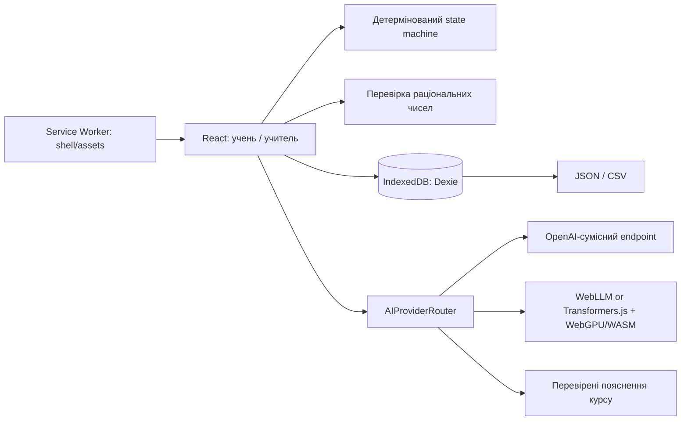

# Архітектура

Статичний React/TypeScript клієнт працює на HTTPS хості. Немає API сервера чи обов’язкового бекенду.

## Потік відповіді

Вправа та правильна відповідь завантажуються з локально зібраної програми. Перевірка приймає точні цілі дроби й скорочує їх на цілі чисельник/знаменник. State machine одержує тільки правильність, номер спроби та детерміновану мітку типової помилки. AI не може виставити оцінку або перемкнути навчальний режим.

Dexie схема v1 має таблиці `attempts`, `requests`, `records`. JSON експорт містить версію схеми; невідома версія відхиляється. У майбутніх змінах БД версія має підвищитися з явною Dexie migration.

## Що зробили учні / сторонні компоненти

- Власні компоненти проєкту: навчальний курс, fraction engine, правила режимів, local-first сховище, teacher intervention flow, маршрутизатор провайдерів, сценарії та сторінки.
- Сторонні: React, Vite, Dexie, vite-plugin-pwa, WebLLM, Transformers.js, Qwen2.5 модель.
- Немає заяви, що команда навчила власну LLM або модель.

## Обмеження

Профілі в одному браузері не є справжніми акаунтами чи синхронізацією. Імпорт JSON — ручний обмін. Налаштування browser API key годяться лише для локальної розробки; спільний deployment потребує власного proxy. Офлайн статус моделі підтверджується після фактичного запуску, а модельні кеші можуть бути видалені браузером/ОС.
