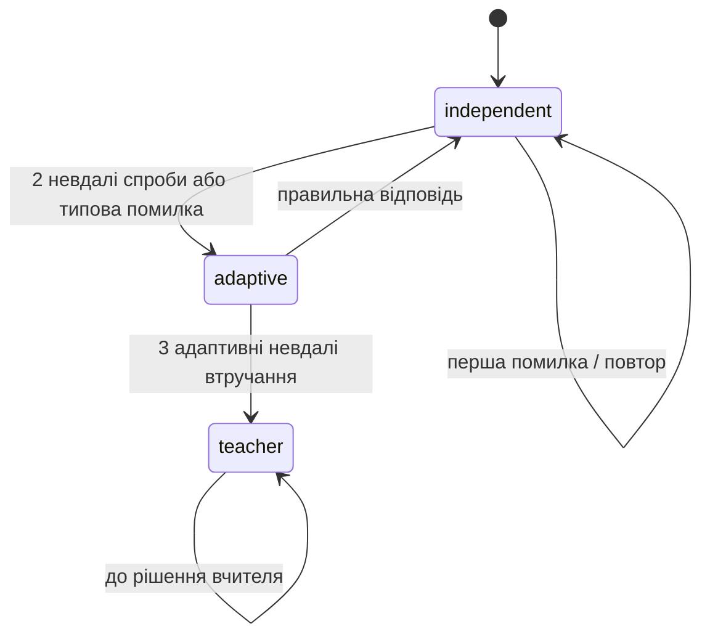

# Алгоритм трьох режимів

`src/learning/stateMachine.ts` — окремий чистий модуль. Однакові вхідні події дають однакове рішення. Порогові значення зібрані в `thresholds`.

Рішення повертає режим, причину й запропоновану дію. Мітку хиби створює детермінований код лише для відомих шаблонів; невідома помилка не приписується учневі як діагноз. Запит вчителю зберігає псевдонім, тему, помилку, спроби адаптації та пропозицію для перегляду. Розблокувати стан у MVP можна, обравши іншу тему; автоматичного фальшивого mastery немає.

Засвоєння теми для маршруту вимагає двох правильних відповідей. Поки це проста демонстраційна евристика, а не валідована психометрична оцінка.
